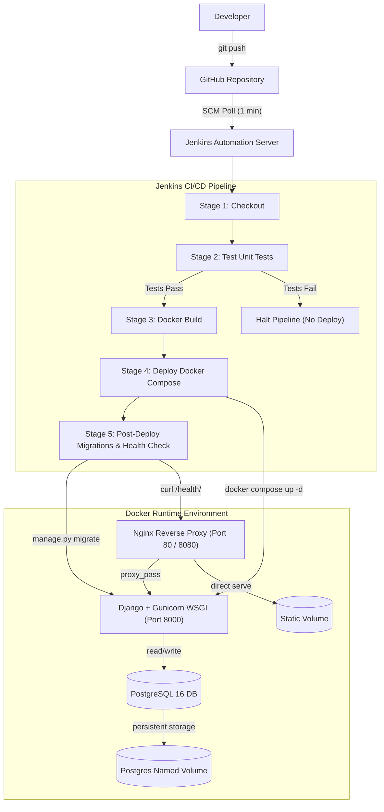

# Inventory and Billing System - End-to-End DevOps CI/CD Pipeline

A production-grade, containerized Django Inventory and Billing web application featuring a fully automated, declarative Jenkins CI/CD pipeline, multi-environment Docker Compose orchestration (Development and Production), and zero-touch database migrations with automated health check verification.

---

## 1. Project Overview and Key Features

This project was developed for the DevOps Final Practical Examination. It demonstrates how modern software delivery pipelines automate the path from source code commit to verified production deployment.

### Application Capabilities
- Product Inventory Management: Create, edit, and list inventory products with SKU, unit price, stock quantities, and real-time stock status badges (In Stock, Low Stock <= 10, Out of Stock).
- Billing and Invoicing: Issue multi-item invoices with automated stock deduction, live total calculation, customer details, and an optional notes field.
- System Health Monitoring: Dedicated `/health/` JSON API endpoint validating HTTP responsiveness and live PostgreSQL database connectivity.
- Responsive Modern UI: Clean, responsive user interface built using vanilla CSS with CSS variables, semantic status badges, and summary statistics cards.

### CI/CD Pipeline Capabilities
- Source-Controlled Pipeline as Code: Fully declared in `Jenkinsfile`.
- Automated Change Detection: SCM polling triggers builds automatically upon code push.
- Isolated Testing: Automated execution of 9 unit tests against an isolated ephemeral database before build artifacts are created.
- Deterministic Image Packaging: Separate Docker builds for Django (with Gunicorn WSGI) and Nginx reverse proxy.
- Parameterized Environments: Deployment target (`dev` on port 8080 or `prod` on port 80) selectable via pipeline parameter.
- Zero-Downtime Verification: Post-deployment database migrations followed by a 15-attempt retry loop on `/health/`.

---

## 2. Technology Stack

| Layer | Technology | Purpose |
| :--- | :--- | :--- |
| Application Framework | Python 3.12 / Django 5.x | Web logic, ORM, forms, and admin interface |
| Application Server | Gunicorn 21.x | Production WSGI HTTP server |
| Reverse Proxy | Nginx 1.27 Alpine | Static file serving, reverse proxy to Gunicorn on port 8000 |
| Database | PostgreSQL 16 Alpine | Relational storage with persistent named volumes |
| Containerization | Docker & Docker Compose v2 | Multi-container orchestration (`web`, `db`, `nginx`) |
| CI/CD Automation | Jenkins 2.x (Dockerized) | Pipeline automation with Docker-in-Docker socket access |
| Version Control | Git & GitHub | Remote repository and SCM change detection |

---

## 3. Architecture and Data Flow

### Architecture Diagram (Mermaid)



### Text Flow Diagram

```text
[Developer]
    |
    v (git push)
[GitHub Repository]
    |
    v (SCM Polling every minute)
[Jenkins Server (Port 8085)]
    |
    +---> Stage 1: Checkout (Pull latest commit)
    +---> Stage 2: Test (Run python manage.py test inside container)
    |            |--> PASS -> Continue
    |            +--> FAIL -> Pipeline stops immediately (Prevents bad builds)
    +---> Stage 3: Build (Build Django & Nginx Docker images)
    +---> Stage 4: Deploy (docker compose up -d for selected dev/prod environment)
    +---> Stage 5: Post-Deploy (Run migrate & poll /health/ retry loop)
                    |
                    v
    +-------------------------------------------------------+
    | Docker Host                                           |
    |  - Client Browser -> Nginx Reverse Proxy (Port 80/8080)|
    |                      |                                |
    |                      +--> /static/ -> Static Volume   |
    |                      +--> /*       -> Django (Port 8000)
    |                                            |          |
    |                                            v          |
    |                                   PostgreSQL (Port 5432)|
    +-------------------------------------------------------+
```

---

## 4. Port Allocations and Endpoints

| Service | Host Port | Internal Port | URL / Path | Description |
| :--- | :--- | :--- | :--- | :--- |
| Jenkins Server | 8085 | 8080 | http://localhost:8085 | Jenkins CI/CD Web Management UI |
| Dev Application | 8080 | 80 | http://localhost:8080 | Development environment (DEBUG=True) |
| Dev Health API | 8080 | 80 | http://localhost:8080/health/ | Dev JSON health check endpoint |
| Prod Application | 80 | 80 | http://localhost/ | Production environment (DEBUG=False) |
| Prod Health API | 80 | 80 | http://localhost/health/ | Production JSON health check endpoint |
| Products View | 8080 / 80 | 80 | /products/ | Inventory list, summary cards, and creation |
| Invoices View | 8080 / 80 | 80 | /invoices/ | Invoices list and billing creation |

---

## 5. Repository File Structure

```text
.
|-- .env.dev                        # Environment variables for dev (DEBUG=True, port 8080)
|-- .env.prod                       # Environment variables for prod (DEBUG=False, port 80)
|-- .dockerignore                   # Docker build context exclusions
|-- .gitignore                      # Git tracking exclusions
|-- Dockerfile                      # Multi-stage production image for Django + Gunicorn
|-- Jenkinsfile                     # 5-stage declarative CI/CD pipeline definition
|-- README.md                       # Comprehensive project documentation
|-- VIVA_EXPLANATION_GUIDE.md       # Exam viva preparation guide with Q&A
|-- deploy.sh                       # Shell deployment automation script (Linux/Git Bash)
|-- deploy.ps1                      # PowerShell deployment automation script (Windows)
|-- docker-compose.dev.yml          # Compose orchestration for development stack
|-- docker-compose.prod.yml         # Compose orchestration for production stack
|-- docker-compose.jenkins.yml      # Compose orchestration for Jenkins with Docker socket
|-- manage.py                       # Django command-line execution entry point
|-- requirements.txt                # Python dependencies (Django, psycopg2-binary, gunicorn)
|-- inventory/                      # Django application directory
|   |-- forms.py                    # ProductForm, InvoiceForm, InvoiceItemFormSet
|   |-- models.py                   # Product, Invoice (with notes), InvoiceItem models
|   |-- views.py                    # CRUD views and health_check JSON view
|   |-- urls.py                     # Application route definitions
|   |-- tests.py                    # 9 automated unit tests
|   |-- migrations/                 # Schema migrations (0001_initial, 0002_invoice_notes)
|   |-- static/inventory/style.css  # Application stylesheet with custom CSS palette
|   +-- templates/inventory/        # HTML templates for products, invoices, and navigation
|-- inventory_project/              # Django project configuration
|   |-- settings.py                 # Settings with environment variable fallbacks
|   |-- urls.py                     # Root routing mapping / and /health/
|   +-- wsgi.py                     # WSGI callable for Gunicorn
|-- jenkins-runner/                 # Custom Jenkins image assets
|   |-- Dockerfile                  # Jenkins base + Docker CLI + Compose plugin + Jenkins plugins
|   +-- security.groovy             # Automated Jenkins admin credential setup script
+-- nginx/                          # Nginx reverse proxy configuration
    |-- Dockerfile                  # Nginx image definition
    +-- default.conf                # Proxy pass rules and static file alias routing
```

---

## 6. How to Run Locally

### Prerequisites
- Docker Desktop installed and running.
- Python 3.12 (optional for running tests without Docker).

### Option A: Running with Docker Compose (Recommended)

1. Start the Development Stack:
   ```bash
   docker compose -f docker-compose.dev.yml up -d --build
   ```

2. Run Database Migrations and Static Collection:
   ```bash
   docker compose -f docker-compose.dev.yml exec web python manage.py migrate
   docker compose -f docker-compose.dev.yml exec web python manage.py collectstatic --noinput
   ```

3. Access the Application:
   - Web App: `http://localhost:8080/`
   - Health Check: `http://localhost:8080/health/`

4. Stop the Development Stack:
   ```bash
   docker compose -f docker-compose.dev.yml down
   ```

### Option B: Running the Production Stack

1. Start the Production Stack:
   ```bash
   docker compose -f docker-compose.prod.yml up -d --build
   ```

2. Run Migrations:
   ```bash
   docker compose -f docker-compose.prod.yml exec web python manage.py migrate
   docker compose -f docker-compose.prod.yml exec web python manage.py collectstatic --noinput
   ```

3. Access the Application:
   - Web App: `http://localhost/`
   - Health Check: `http://localhost/health/`

---

## 7. How the Jenkins CI/CD Pipeline Works

### 1. Launching Jenkins
The custom Jenkins runner includes Docker CLI, Docker Compose, Git, and the Pipeline Stage View plugin. It is started with:
```bash
docker compose -f docker-compose.jenkins.yml up -d
```
- URL: `http://localhost:8085/`
- Username: `admin`
- Password: `admin123`

### 2. Pipeline Stages Explained

```text
+-------------------+--------------------------------------------------------------+
| Stage             | What it does                                                 |
+-------------------+--------------------------------------------------------------+
| 1. Checkout       | Pulls latest source code commit from the GitHub repository.  |
| 2. Test           | Runs unit tests inside an isolated test container.           |
|                   | Halts immediately on failure to prevent deploying bugs.      |
| 3. Build          | Builds Docker images for Django (web) and Nginx.             |
| 4. Deploy         | Runs docker compose up -d using the target environment file. |
| 5. Post-Deploy    | Executes database migrations inside web container and polls  |
|                   | /health/ up to 15 times until HTTP 200 is confirmed.         |
+-------------------+--------------------------------------------------------------+
```

### 3. Automatic Triggering (SCM Polling)
The pipeline is configured with:
```groovy
triggers {
    pollSCM('* * * * *')
}
```
Every 60 seconds, Jenkins checks GitHub for new commits on branch `main`. When a new commit is detected, Jenkins launches a build automatically without manual intervention.

---

## 8. Verification and Live Demonstration

### Test Suite Execution
Run tests locally:
```bash
python manage.py test
```
Or execute inside the running container:
```bash
docker exec inventory_dev_web python manage.py test
```
Result: All 9 tests pass in under 0.5 seconds, testing model constraints, stock validation, invoice creation, and the health check endpoint.

### Model Change Demo (Zero-Touch Deployment)
1. Added `notes` field to `Invoice` model in `inventory/models.py`.
2. Generated migration `0002_invoice_notes.py`.
3. Pushed commit to GitHub.
4. Jenkins automatically detected the commit, ran all tests, built images, deployed containers, applied migration `0002_invoice_notes.py`, and verified the health endpoint.
5. Live verified on `http://localhost:8080/invoices/create/` with the notes field active.

---

## 9. Known Limitations and Future Enhancements

1. Single-Node Docker Engine:
   - Current: Single-node Docker daemon via socket mount.
   - Enhancement: Multi-node orchestration using Kubernetes (EKS/GKE) or Docker Swarm for high availability and zero-downtime rolling updates.
2. SCM Polling vs. Webhook:
   - Current: Polling every 1 minute due to local private network constraints (GitHub cannot reach private host without a tunnel).
   - Enhancement: Deploy Jenkins on a public cloud VM or use Cloudflare Tunnel / ngrok to support instant GitHub push webhooks.
3. Secrets Management:
   - Current: `.env` configuration files with placeholder values.
   - Enhancement: Production-grade secrets management using HashiCorp Vault or AWS Secrets Manager.
4. Container Registry:
   - Current: Local image cache.
   - Enhancement: Push version-tagged images to Docker Hub, GitHub Container Registry (GHCR), or AWS ECR.
